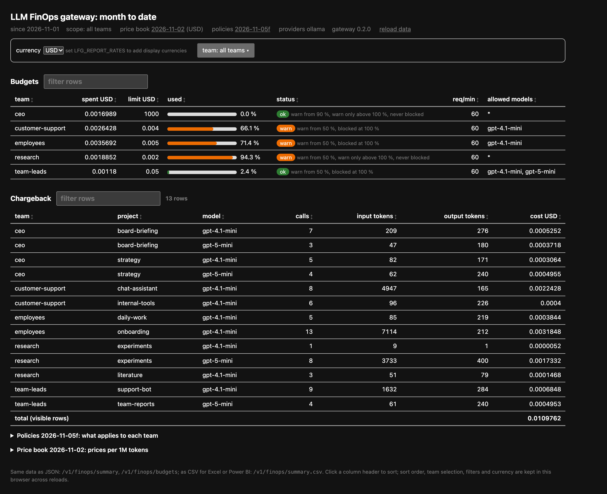

# Reporting: the built-in page, CSV, JSON and the database

The ledger has one row per call. Everything below is a view of it (ADR-0016).

## Who sees what

| Caller | `api_key` mode (production) | `headers` mode (development) |
| --- | --- | --- |
| Team key (`role: team`, default) | its own team, every project | everything |
| Key with `role: finops` | every team; filter with `X-Team` or `?team=` | everything |
| No key | 401 (JSON) or the login form (HTML page) | everything |

Create a FinOps key the same way as a team key:

```bash
llm-finops-gateway keys new --team finops --id finops-reporting --role finops
```

The key's own team name does not matter for reading; `role: finops` is what grants the
all-teams view. Rotate and disable it like any other key.

## The page: `GET /finops`



Open `http://<gateway>/finops` in a browser. In `api_key` mode it asks for a key once and keeps
it in an HttpOnly session cookie; `/finops/logout` clears it. The page shows:

- budgets per team: spent, limit, used %, warn and block thresholds, enforcement, requests per
  minute, allowed models;
- the chargeback table (team, project, model, calls, tokens, cost) and the total;
- price book version and currency, policy version, configured providers, gateway version.

The default view is server-rendered; a few hundred lines of inline JavaScript (no build step,
no external files) add: sorting on any column, a text filter per table, a team selector (all
teams or any subset, the total follows), a display currency switch (`LFG_REPORT_RATES`, for
example `{"EUR": 0.88}`; display only, the ledger stays in the book's currency), and the
policy and price book views behind their version links: the effective policy per team with
the defaults row, the raw `policies.yaml`, and prices per 1M tokens. Selections are kept in
the browser's local storage.

## Spreadsheets and BI tools

`GET /v1/finops/export.focus.csv?from=2026-11-01&to=2026-12-01` returns the ledger in the
FinOps Open Cost and Usage Specification (FOCUS) format, one row per team, project, use case,
provider, model, price book version and UTC day, with the mandatory FOCUS 1.1 columns and
`x_` columns for token detail (ADR-0023); `llm-finops-gateway ledger export --from ... --to ...`
writes the same file from the command line for scheduled loads into a FOCUS dataset. Four rows
of an export, columns trimmed (`Tags` holds the project and use case as JSON):

| ChargePeriodStart | SubAccountId | Tags | ResourceId | ConsumedQuantity | x_Calls | x_CachedInputTokens | BilledCost |
| --- | --- | --- | --- | ---: | ---: | ---: | ---: |
| 2026-11-05 | customer-support | project=chat-assistant, use_case=faq | gpt-4.1-mini | 2079 | 7 | 0 | 0.0010284 |
| 2026-11-05 | customer-support | project=chat-assistant, use_case=summaries | gpt-4.1-mini | 3033 | 1 | 0 | 0.0012144 |
| 2026-11-05 | employees | project=onboarding, use_case=faq | gpt-4.1-mini | 7326 | 13 | 0 | 0.0031848 |
| 2026-11-05 | ceo | project=board-briefing, use_case=docs-qa | gpt-5-mini | 227 | 3 | 0 | 0.00037175 |

`GET /v1/finops/summary.csv` returns the chargeback rows as CSV with the same access rule, and
the ledger database has a read-only role (`lfg_reporting` on the Azure deployment,
[database.md](database.md)). That is the whole contract: any spreadsheet or BI tool that can
read a CSV over HTTPS with an `Authorization` header, or a PostgreSQL table with a read-only
user, can show the chargeback. The core does not ship or test a model for a particular BI
product; building one (row-level security, SSO, branding, scheduled refresh) is the enterprise
layer's job, with whichever tool the organisation already pays for.

## Where each view lives in Azure

Nothing here is a separate service to deploy; the question is only who opens what.

| Audience | View | Where it is in Azure |
| --- | --- | --- |
| Developers, team leads | the report page | the gateway's own URL plus `/finops`: `https://<container-app>.<env>.<region>.azurecontainerapps.io/finops`, with the team key. Put Container Apps authentication (Entra ID) or API Management in front so only signed-in staff reach it; use internal ingress and a VNet when it must stay private. |
| FinOps practitioners, finance | chargeback and trends | the organisation's BI tool, fed from `/v1/finops/summary.csv` or the JSON with a `role: finops` key, or reading the ledger in Azure Database for PostgreSQL with the `lfg_reporting` role |
| Platform operations | the Grafana dashboard | Azure Monitor managed Prometheus scrapes `/metrics` from the Container App (enable the Prometheus add-on and a pod/app annotation or a scrape job); import `grafana/llm-finops-gateway.json` into Azure Managed Grafana and pick that data source. Azure Monitor Workbooks can show the same metrics without Grafana. |
| Everyone who needs to be told | alerts | the webhook to Slack or to a Teams Workflows "post to a channel" flow (`LFG_ALERT_FORMAT=teams`); for SLO-style rules, Azure Monitor alert rules on the Prometheus metrics with action groups (email, SMS, Teams, ITSM). |
| Finance reconciliation | the invoice | Azure Cost Management shows the Azure OpenAI resource's bill as a whole; it has no team dimension. `pricing sync` keeps the price book at the invoice's unit prices; the ledger supplies the split. |

Email alerts are not sent by the gateway itself: route the webhook through a Teams or Power
Automate flow that sends mail, or use an Azure Monitor action group. Test any channel with
`llm-finops-gateway alerts test`, which sends one sample event to `LFG_ALERT_WEBHOOK_URL`.

## What belongs where

- Core (this repository): the access rule, the HTML page, CSV and JSON, the ledger schema.
- Also in core: the FOCUS export, the Grafana dashboard for the Prometheus metrics
  (operational view, not chargeback), the report inside the LiteLLM dashboard.
- Later in core: per-user identity on the report through OIDC groups.
- Enterprise layer: the BI model (whatever the tool) with row-level security and SSO,
  customer branding, approval workflows for budget changes, ERP exports.
