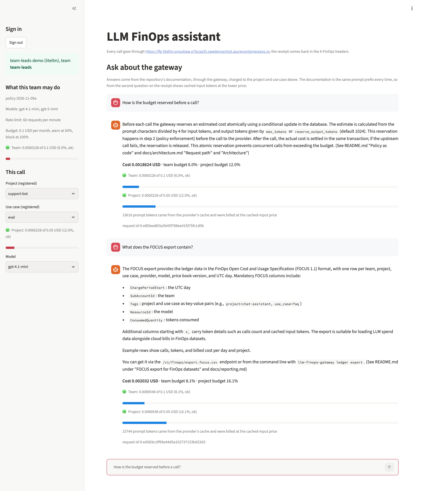

# Assistant example

A Streamlit page that answers questions about this project from its documentation, through
the gateway or the LiteLLM plugin, and shows the FinOps receipt (cost, cached input tokens,
team and project budget, warnings, rejections) next to every answer. The documentation is the
system prompt of every call, so the demo traffic is attributed and priced like any other call,
and from the second question on the receipt shows the provider's prompt cache at work.

Sign in with an API key (a gateway `lfg_` key or a LiteLLM virtual key) and the page reads
back what the policy says about it: the team the key belongs to, its allowed models, rate
limit and budget, and the team's registered projects with their use cases and budgets, so the
project and use case are picked from lists where a registry exists. A LiteLLM key that carries
a default project in its metadata has it preselected. Nothing is configured on the page itself.



```bash
pip install "llm-finops-gateway[assistant]"
LFG_ASSISTANT_TARGET_URL=http://localhost:4001 \
LFG_ASSISTANT_REPORT_URL=http://localhost:8081 \
streamlit run examples/assistant/app.py
```

`examples/litellm/docker-compose.yml` runs it on port 8501 next to the LiteLLM stack; its
`demo.sh` creates the keys in `.demo-keys/`, one file per team, to hand out to the people trying
the page. The environment variables are listed at the top of `app.py`.
